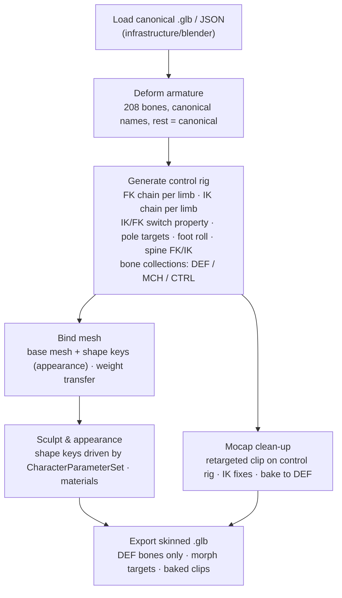
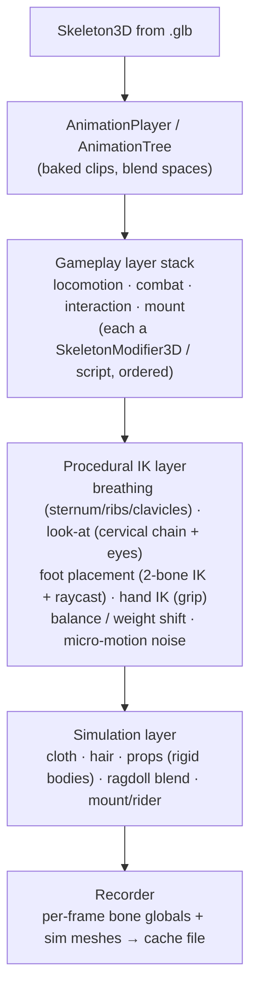

# Production vs. Runtime — Separation Architecture and Roadmap

**Date:** 2026-09-29 · **Status:** PROPOSED (architecture fixed, content phased)
**Complements:** `docs/reorientation/TARGET_ARCHITECTURE.md` (§3 production flow, §5 manifolds, §16 horse, §17 cinematography)

This document fixes the boundary between the three worlds the project has to serve, so that
work in one never leaks into the others:

| World | Tool | Purpose | Owns |
|-------|------|---------|------|
| **Canonical core** | Python (`src/character_engine`) | Truth: anatomy, parameters, provenance | JSON data, domain, exporters |
| **Production** | Blender (3.6 reference) — the whole production line | Modelling, sculpt, appearance, rig, animation, mocap clean-up, cinematography, final render | `.blend` files, control rigs, shaders, render |
| **Runtime** | Godot 4 (primary, gating) | Gameplay, procedural IK, physics simulation | Scenes, gameplay code, simulation caches |

Owner decision 2026-10-24 (DECISION_LOG §40, §42): production happens in Blender, gameplay runtime in Godot.
UPBGE (authoring + game mode) remains supported but optional and non-blocking.

The two engines only ever talk to each other through **neutral files** produced or consumed by
the core. Nothing in production depends on runtime code and vice versa.

---

## 1. Boundary diagram

```mermaid
flowchart LR
    subgraph CORE["CANONICAL CORE (pure Python · source of truth)"]
        DATA[("human_adult_206.json<br/>references/*.json<br/>provenance")]
        DOM["domain: osteology · joints · landmarks<br/>proportions · reconstruction"]
        PARAM["CharacterParameterSet<br/>(stature, segment ratios, morph weights…)"]
        EXP["exporters: glTF 2.0 skeleton · glTF animation<br/>parameter JSON · bone-map"]
        DATA --> DOM --> PARAM --> EXP
    end

    subgraph PROD["PRODUCTION (Blender / UPBGE authoring)"]
        IMP["infrastructure/blender<br/>BlenderImporter · StateAuditor"]
        RIG["Rig generator<br/>deform bones + control rig (IK/FK)"]
        SCULPT["Sculpt / appearance<br/>shape keys · textures · materials"]
        MOCAP["Mocap retarget<br/>BVH/FBX → canonical bone-map"]
        RENDER["Cinematic render<br/>(Cycles / EEVEE)"]
        IMP --> RIG --> SCULPT
        MOCAP --> RIG
    end

    subgraph RT["RUNTIME (Godot 4 / UPBGE game mode)"]
        LOAD["Skeleton3D / Armature<br/>from .glb"]
        GP["Gameplay layers<br/>(locomotion, combat, interaction…)"]
        PIK["Procedural IK layer<br/>breathing · look-at · foot · hand · balance"]
        SIM["Simulation<br/>cloth · hair · props · ragdoll · mount"]
        REC["Simulation recorder<br/>per-frame transforms → cache"]
        LOAD --> GP --> PIK --> SIM --> REC
    end

    EXP -- ".glb skeleton (Y-up)<br/>parameters.json" --> IMP
    EXP -- ".glb skeleton + clips" --> LOAD
    RIG -- ".glb / .fbx skinned mesh<br/>+ baked clips" --> LOAD
    REC -- "Alembic .abc / USD / glTF anim<br/>(simulation cache)" --> RENDER
    MOCAP -- ".glb animation clips" --> LOAD
```



**Rules**

1. Arrows into `PROD` or `RT` are always *files* (glTF, Alembic, USD, JSON). No engine calls the core at run time.
2. `RT → PROD` happens only through **simulation caches** (baked per-frame transforms/meshes). Runtime never writes `.blend`.
3. `PROD → RT` happens only through **skinned glTF + clips**. Blender control rigs (IK targets, pole vectors, widgets) are *never* exported; only deform bones matching the canonical names.
4. Canonical names are the contract everywhere: `FEMUR_L` is `FEMUR_L` in JSON, Blender, Godot, mocap bone-maps and caches.

---

## 2. Data contracts (file formats)

| Contract | Format | Producer → Consumer | Status |
|----------|--------|---------------------|--------|
| Canonical skeleton | `human_adult_206.json` (Z-up, m) | core → core | ✅ exists |
| Engine skeleton | glTF 2.0 `.glb` (Y-up), 208 nodes, extras `ce_*` | core → Godot / Blender | ✅ `export/gltf.py` |
| Character parameters | `character_parameters.json` (stature, ratios, morph weights, population source ids) | editor → core (retarget) → engines | 🔜 P1 |
| Rig definition | `rig_definition.json` (deform bone list, IK chains, FK/IK switches, limits) derived from canonical joints | core → Blender rig generator | 🔜 P2 |
| Bone map | `bone_map_<source>.json` (Mixamo/BVH/Rokoko names → canonical) | core → mocap retarget | 🔜 P3 |
| Animation clips | glTF animation channels on canonical nodes (or BVH for archive) | Blender / mocap → Godot | 🔜 P3 |
| Skinned character | glTF `.glb` (mesh + skin + morph targets + clips) | Blender → Godot | 🔜 P2 |
| Simulation cache | Alembic `.abc` (meshes) + glTF animation (bones) or USD | Godot/UPBGE → Blender | 🔜 P5 |
| Animal skeleton | `<species>_<n>.json` + `.glb` (same schema, different bone set) | core → both | 🔜 P6 |

Every new contract gets a JSON schema in `src/character_engine/schema/`, a test in `tests/`,
and a validator in `runtime/` before content is produced against it.

---

## 3. Production side (Blender / UPBGE authoring)



Design constraints:

- **Deform bones = canonical bones.** IK/FK/control bones live in separate bone collections and
  carry a `ce_role` custom property (`DEF`, `MCH`, `CTRL`); the exporter filters on it.
- **IK/FK switching** is a per-limb float property (0 = FK, 1 = IK) with snapping operators, the
  same model Rigify uses. The generator is ours (driven by `rig_definition.json`), not Rigify
  itself, so animals and historical variants use the same code path.
- **Appearance is parametric first, sculpt second.** Shape keys generated from
  `CharacterParameterSet` (stature, segment ratios, breadths) give the base; artists sculpt on top
  as an additional corrective shape key so the parametric layer can still be re-run.
- The Blender adapter (`src/character_engine/infrastructure/blender/`) stays the *only* `bpy` code
  in the package; rig generation goes there as `rig_generator.py`.

---

## 4. Runtime side (Godot 4 / UPBGE game mode)



Design constraints:

- Godot 4.3+ **`SkeletonModifier3D`** is the extension point: each gameplay/IK feature is one
  modifier node under `Skeleton3D`, with an explicit order and an `influence` weight. This is
  what "add different gameplays" means concretely: drop in a modifier, no rig changes.
- **Breathing IK**: a modifier that scales/rotates `STERNUM`, `RIB_*`, `CLAVICLE_*` and adds a
  small `THORACIC_*` extension on a breathing curve (rate, depth driven by exertion). Because it
  targets canonical names, the same modifier works on any character exported from the core.
- UPBGE mirrors the same stack with Python components on the armature (`bge.logic`), sharing
  the JSON that describes the layer order so both runtimes behave the same.
- **Recorder** writes Alembic (via Godot `GLTFDocument` for bones + a mesh cache exporter) or a
  glTF animation with one channel per canonical node. Production imports that cache to render
  cinematics: the simulation is *extracted*, never re-simulated in Blender.

---

## 5. Roadmap

| Phase | Deliverable | Where | Depends on |
|-------|-------------|-------|------------|
| **P0** ✅ | Canonical skeleton at 1.80 m, glTF export, Godot/UPBGE validators | core, runtime | — |
| **P1 Character editor** 🟡 | `CharacterParameters` + templates (`domain/character`, A08): stature, sex, age, species, pose; `stature_retarget.py` as a domain module; Blender *Body* panel and Godot dock (asset + stature). **Done**: male/female/child/elderly templates with provenance, T-pose. **Open**: morph weights, population presets **only from sourced anthropometric tables** (ANSUR II, NHANES, CAESAR) — never hard-coded "ethnic" numbers | core + infra/blender + runtime/godot | P0 |
| **P2 Rig generator (IK/FK)** ✅ | `domain/rigging/HUMANOID_RIG` (chains, targets, FK/IK properties); addon `build_control_rig` builds DEF/MCH/CTRL, IK arms/legs with auto pole, FK/IK blend, foot roll, breath control; export to `.glb`; tests round-trip bone names / rest deviation | domain + infra/blender | P1 |
| **P3 Mocap** 🟡 | Bone-map registry (`domain/animation`: Mixamo, CMU BVH, Rokoko, Rigify DEF); BVH import + rest-to-rest retarget in the addon; clip export via scene GLB (`ACTIVE_ACTIONS`). **Open**: Xsens/FBX maps, Godot clip-playback validator | core + infra/blender + runtime | P2 |
| **P4 Runtime IK & gameplay layers** 🟡 | Godot `CEBreathing` (`SkeletonModifier3D`) + Shenmue-style combat (`CEShenmueCombat`, `CEArena`, dock style selector); UPBGE `ce_combat` component. **Open**: look-at, foot/hand IK, balance, layer-order JSON, further gameplay styles (`souls_like`, `beat_em_up` declared) | runtime/godot, runtime/upbge | P2 |
| **P5 Simulation & extraction** | Cloth/hair/props/ragdoll setup; recorder to Alembic/glTF; Blender import script; cinematic render scene template ("manifold final") | runtime + infra/blender | P4 |
| **P6 Animals** 🔴 | Canonical horse skeleton (`equus_caballus_<n>.json`) with provenance; same schema, exporter and validators; rider–mount interaction contract (§16 target architecture). Templates `horse_adult` / `dog_adult` exist with `available=False` (UNKNOWN) and are refused by the addon until data exists | core + all | P2, sourced data |
| **P7 Tissues & trauma** 🟡 | Tissue layers, muscle attachment catalogue, wound assessment (`domain/tissue`, `domain/trauma`, ESTIMATE grade); addon tissue proxies + wound raycast; Godot/UPBGE wound markers from combat hits. **Open**: sourced thicknesses, real meshes (`assets/anatomy/meshes/`) | core + infra/blender + runtime | P1 |

Each phase closes with the `audit-phase-closure` skill: contract doc in `docs/audit/`, tests, evidence.

---

## 6. Repository layout (as implemented in A08; planned files marked *)

```
src/character_engine/
  domain/anatomy/osteometry/        # Trotter regressions -> bone lengths (mesh extents only)
  domain/anatomy/pose/tpose.py      # anatomical / T-pose / A-pose
  domain/anatomy/proportions/stature_retarget.py
  domain/character/templates.py     # CharacterParameters, templates, build_character_bones
  domain/tissue/, domain/trauma/    # layers, muscles, wound assessment (ESTIMATE grade)
  domain/rigging/rig_definition.py  # HUMANOID_RIG (pure Python)
  domain/animation/bone_map.py      # Mixamo / CMU / Rokoko / Rigify maps
  domain/gameplay/combat.py         # ShenmueCombat; runtime_table.py -> JSON for Godot
  export/gltf.py                    # --pose / --template / --stature
  infrastructure/blender/addon/     # bpy: panels, operators, build (body, tissues, rig, mocap,
                                    #      wounds, export), runtime_upbge (scene, component)
runtime/blender/ce_addon_headless_test.py   # Blender + UPBGE suites (23 checks)
runtime/upbge/components/ce_combat.py       # KX_PythonComponent / logic-brick entry
runtime/godot/addons/character_engine/      # plugin.cfg, plugin.gd, ce_dock.gd, ce_character.gd,
  gameplay/ce_shenmue_combat.gd             #   GDScript port (replays reference fights)
  gameplay/ce_fighter_controller.gd, gameplay/ce_arena.gd
  modifiers/ce_breathing.gd                 #   SkeletonModifier3D
  modifiers/ce_lookat.gd *, modifiers/ce_foot_ik.gd *, ce_layer_stack.gd *, ce_sim_recorder.gd *
  data/gameplay_shenmue.json                #   generated by scripts/export_gameplay_data.py
runtime/godot/tests/ce_test_runner.gd       # headless suite (21 checks)
scripts/engine_tests.py                     # blender -> upbge -> godot orchestration
data/anatomy/references/osteometry.json
data/anatomy/<species>_<n>.json *           # P6
schema/character_parameters.schema.json *, rig_definition.schema.json *, bone_map.schema.json *
```

`scripts/lint.py` keeps enforcing: `bpy` only under `infrastructure/` and `runtime/`; the new
`domain/rigging` and `domain/animation` packages are pure Python like the rest of the domain.
