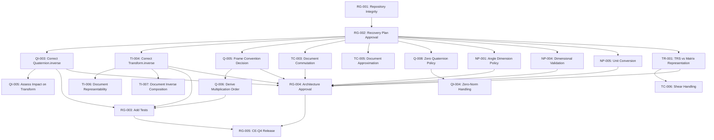

# S2-D1-R21-MATHEMATICAL-DECISION-REGISTER

**Documento**: S2-D1-R21-MATHEMATICAL-DECISION-REGISTER
**Fase**: S2-D1-R21
**Tipo: Registro de Decisiones Matemáticas
**Modo: Análisis y síntesis
**Estado**: COMPLETADO
**Fecha**: 2026-10-14
**Propósito**: Síntesis ejecutiva de hallazgos matemáticos R6-R19 para guiar la próxima revisión de arquitectura

---

## 1. EXECUTIVE SUMMARY

**Estado actual**: Character Engine tiene una infraestructura matemática parcialmente verificada con defectos conocidos en implementación crítica y contratos no definidos para cinemática.

**Hallazgos clave**:
- Matriz TRS y convenciones de cuaternión están **VERIFICADAS** y son consistentes
- **Quaternion.inverse()** tiene un **DEFECTO MATEMÁTICO CONFIRMADO** (divide por ||q|| en lugar de ||q||²)
- **Transform.inverse()** usa fórmula incorrecta (falta S⁻¹ en traslación inversa)
- **Transform.compose()** produce resultado aproximado, no exacto cuando rotación y escala no conmutan
- **Frame convention** para velocidad angular está **NO DEFINIDA** (discrepancia entre código y comentario)
- **Seis decisiones de policy** de diseño están pendientes de aprobación
- **Integridad del repositorio** está **BLOQUEADA** (5815 archivos staged con origen indeterminado)

**CE-Q4**: BLOQUEADO hasta resolver defectos matemáticos, frame convention, y políticas de diseño

---

## 2. SOURCE COVERAGE AND LIMITATIONS

### 2.1 Documents Inspected

**Fully inspected**:
- `S2-D1-R18-TRS-CORRECTION.md` - Composición e inversa TRS (correcciones matemáticas)
- `S2-D1-R19-TRS-CORRECTION.md` - Correcciones documentales a R18
- `S2-D1-R19-INDEPENDENT-AUDIT.md` - Auditoría independiente de R18/R19
- `S2-D1-R19-SCOPE-GATE.md` - Verificación de alcance de R19
- `S2-D1-R20-A-FORENSIC-REPORT.md` - Estado forense del repositorio
- `S2-D1-R20-B-RECOVERY-PLAN.md` - Plan de recuperación (no ejecutado)
- `S2-D1-R20-C-ROTATION-TRS-ARCHITECTURE-REVIEW.md` - Revisión de arquitectura (bloqueada)
- `S2-D1-R20-LITE-STATUS.md` - Estado mínimo y copia de seguridad
- `S2-D1-R13-CONSISTENCY-REVIEW.md` - Sección de políticas (seis decisiones)
- `S2-D1-R10-EXPONENTIAL-CONVERGENCE-AUDIT.md` - Exponenciales y convergencia

**Not inspected** (not required for synthesis):
- R6-R9, R11-R12, R14-R17 (summaries captured via R13 and R19)
- Source code (only used when cited by audits)

### 2.2 Evidence Gaps

**Missing**:
- Requisitos específicos de interoperabilidad con Blender, UPBGE, Godot (no documentados en auditorías)
- Evidence de uso real de Transform en producción (R10 reporta "ningún uso demostrado")
- Validation de convergencia por ejecución (R13 reporta "requiere ejecución")
- Justificación detallada de las seis políticas de diseño (R13 lista pero no detalla)

**Assumptions**:
- Las seis políticas de diseño listadas en R13 son completas (no verificado independientemente)
- Los cambios staged contienen trabajo legítimo (no establecido por R20-A)

---

## 3. DECISION REGISTER

### 3.1 Quaternion Contract

| ID | Decision/Finding | Current Evidence | Severity | Dependencies | Proposed Owner/Action | Status |
|----|------------------|------------------|----------|--------------|------------------------|--------|
| Q-001 | Component order: (w, x, y, z) | CONFIRMED_BY_SOURCE (quaternion.py lines 24-30, R19 §11.1) | P0 | None | Maintained (no change needed) | VERIFIED |
| Q-002 | Hamilton product convention | CONFIRMED_BY_SOURCE (quaternion.py lines 72-82, R19 §11.1) | P0 | None | Maintained (no change needed) | VERIFIED |
| Q-003 | Active rotation: q * p * q⁻¹ | CONFIRMED_BY_SOURCE (quaternion.py lines 91-101, R19 §11.2) | P0 | None | Maintained (no change needed) | VERIFIED |
| Q-004 | Parent-child composition: q_global = q_parent * q_local | CONFIRMED_BY_SOURCE (transform.py lines 54-68, R19 §11.3) | P0 | None | Maintained (no change needed) | VERIFIED |
| Q-005 | Frame convention for angular velocity | CONFLICTING_EVIDENCE (code: spatial, comment: body, R19 §11.4, R19-INDEPENDENT-AUDIT A-014) | P0 | Q-001, Q-002, Q-004 | Human decision required | OPEN |
| Q-006 | Quaternion derivative multiplication order | REPORTED_NOT_VERIFIED (R19 §11.4, R10 §2.1: implementation uses left multiplication) | P0 | Q-005 | Derive from Q-005 decision | BLOCKED |
| Q-007 | Unit normalization and numerical tolerances | REPORTED_NOT_VERIFIED (R19 §10.4, R10: normalize() divides by ||q||) | P1 | Q-008 | Define tolerance policy | OPEN |
| Q-008 | Zero quaternion behavior | CONFIRMED_BY_SOURCE (quaternion.py lines 44-54, R19 §10.5, R19-INDEPENDENT-AUDIT A-011) | P1 | Q-009 | Human decision: error vs identity | OPEN |
| Q-009 | Double-cover handling and SLERP sign selection | REPORTED_NOT_VERIFIED (R19 §11.6, R13: Double-Cover Policy OPEN) | P2 | None | Human decision required | OPEN |

### 3.2 Quaternion Inverse

| ID | Decision/Finding | Current Evidence | Severity | Dependencies | Proposed Owner/Action | Status |
|----|------------------|------------------|----------|--------------|------------------------|--------|
| QI-001 | General quaternion inverse formula: q⁻¹ = q* / ||q||² | CONFIRMED_BY_SOURCE (R19 §10.2, R19-INDEPENDENT-AUDIT A-010) | P0 | None | Mathematical standard | VERIFIED |
| QI-002 | Unit quaternion inverse: q⁻¹ = q* (when ||q|| = 1) | CONFIRMED_BY_SOURCE (R19 §10.3) | P0 | None | Mathematical standard | VERIFIED |
| QI-003 | Implementation defect: divides by ||q|| instead of ||q||² | CONFIRMED_BY_SOURCE (quaternion.py line 70, R19 §10.4, R19-INDEPENDENT-AUDIT A-010) | P0 | QI-001 | Correct implementation | BLOCKED |
| QI-004 | Zero-norm behavior: returns identity instead of error | CONFIRMED_BY_SOURCE (quaternion.py lines 44-54, R19 §10.5, R19-INDEPENDENT-AUDIT A-011) | P1 | Q-008 | Implement error or define policy | BLOCKED |
| QI-005 | Impact on Transform.inverse() | REPORTED_NOT_VERIFIED (R19 §10.6: impact if rotation non-unit) | P1 | QI-003, TI-001 | Assess after QI-003 correction | OPEN |

### 3.3 Transform Inverse

| ID | Decision/Finding | Current Evidence | Severity | Dependencies | Proposed Owner/Action | Status |
|----|------------------|------------------|----------|--------------|------------------------|--------|
| TI-001 | Matrix convention: M = T @ R @ S | CONFIRMED_BY_SOURCE (matrix4.py lines 16-37, transform.py line 193, R18 §2.1, R19-INDEPENDENT-AUDIT A-001) | P0 | None | Maintained (no change needed) | VERIFIED |
| TI-002 | Exact matrix inverse: M⁻¹ = S⁻¹ @ R⁻¹ @ T(-p) | CONFIRMED_BY_SOURCE (R18 §2.3, R19 §4.1, R19-INDEPENDENT-AUDIT A-005) | P0 | TI-001 | Mathematical standard | VERIFIED |
| TI-003 | Inverse translation (exact): p_inv = -S⁻¹ @ R⁻¹ @ p | CONFIRMED_BY_SOURCE (R19 §6.1, R19-INDEPENDENT-AUDIT A-005) | P0 | TI-002 | Correct if representable | BLOCKED |
| TI-004 | Implementation: p_inv = R⁻¹ @ (-p) (missing S⁻¹) | CONFIRMED_BY_SOURCE (transform.py lines 195-199, R19 §7.1, R19-INDEPENDENT-AUDIT A-005) | P0 | TI-003 | Correct implementation | BLOCKED |
| TI-005 | Scale preconditions: positive only | CONFIRMED_BY_SOURCE (transform.py lines 189-190, R18 §2.3, R19 §2.3) | P1 | None | Maintained (no change needed) | VERIFIED |
| TI-006 | Representability condition: R @ S⁻² @ R^T must be diagonal | CONFIRMED_BY_SOURCE (R19 §5.1, R19-INDEPENDENT-AUDIT A-006) | P1 | TI-003 | Document limitation | BLOCKED |
| TI-007 | Composition with inverse: identity requires p=0 or s=(1,1,1) | CONFIRMED_BY_SOURCE (R19 §8.2-8.3, R19-INDEPENDENT-AUDIT A-007) | P1 | TI-004 | Document limitation | BLOCKED |

### 3.4 Transform Composition

| ID | Decision/Finding | Current Evidence | Severity | Dependencies | Proposed Owner/Action | Status |
|----|------------------|------------------|----------|--------------|------------------------|--------|
| TC-001 | Exact matrix composition: L_exact = R₁ @ S₁ @ R₂ @ S₂ | CONFIRMED_BY_SOURCE (R18 §3.1, R19 §3.1, R19-INDEPENDENT-AUDIT A-002) | P0 | TI-001 | Mathematical standard | VERIFIED |
| TC-002 | Field-wise composition: L_compose = R₁ @ R₂ @ S₁ @ S₂ | CONFIRMED_BY_SOURCE (transform.py lines 201-205, R18 §3.2, R19-INDEPENDENT-AUDIT A-004) | P0 | None | Current implementation | VERIFIED |
| TC-003 | Commutation condition: S₁ @ R₂ = R₂ @ S₁ for exact match | CONFIRMED_BY_SOURCE (R18 §3.3, R19 §3.3, R19-INDEPENDENT-AUDIT A-003) | P0 | None | Document API contract | BLOCKED |
| TC-004 | Nonuniform scale and rotation do not commute | CONFIRMED_BY_SOURCE (R19 §9.7, R19-INDEPENDENT-AUDIT A-009) | P0 | None | Document API contract | BLOCKED |
| TC-005 | compose() is approximate, not exact in general | CONFIRMED_BY_SOURCE (R19 §9.6, R19-INDEPENDENT-AUDIT A-004) | P1 | TC-003, TC-004 | Document limitation | BLOCKED |
| TC-006 | Shear handling | UNKNOWN (no evidence in R6-R19) | P2 | TR-001 | Define or prohibit shear | OPEN |

### 3.5 Representation and Engine Interoperability

| ID | Decision/Finding | Current Evidence | Severity | Dependencies | Proposed Owner/Action | Status |
|----|------------------|------------------|----------|--------------|------------------------|--------|
| TR-001 | TRS-only vs general matrix representation | UNKNOWN (R20-C blocked, no evidence in R6-R19) | P1 | TC-006 | Human decision required | OPEN |
| TR-002 | Shear requirements for Blender | UNKNOWN (no evidence in R6-R19) | P2 | TR-001 | Verify with Blender docs | OPEN |
| TR-003 | Shear requirements for UPBGE | UNKNOWN (no evidence in R6-R19) | P2 | TR-001 | Verify with UPBGE docs | OPEN |
| TR-004 | Shear requirements for Godot | UNKNOWN (no evidence in R6-R19) | P2 | TR-001 | Verify with Godot docs | OPEN |
| TR-005 | Coordinate system: Z-up, right-handed, -Y forward | CONFIRMED_BY_SOURCE (AGENTS.md, project rules) | P0 | None | Maintained (no change needed) | VERIFIED |
| TR-006 | Export conversion: (x, y, z) → (x, z, -y) | CONFIRMED_BY_SOURCE (AGENTS.md) | P0 | TR-005 | Maintained (no change needed) | VERIFIED |

### 3.6 Numerical Policy (Six Decisions from R13)

| ID | Decision/Finding | Current Evidence | Severity | Dependencies | Proposed Owner/Action | Status |
|----|------------------|------------------|----------|--------------|------------------------|--------|
| NP-001 | Angle Dimension Policy | REPORTED_NOT_VERIFIED (R13 §8.1.3: OPEN, requires user approval) | P1 | None | Human decision required | OPEN |
| NP-002 | Double-Cover Policy | REPORTED_NOT_VERIFIED (R13 §8.1.3: OPEN, requires user approval) | P2 | Q-009 | Human decision required | OPEN |
| NP-003 | Point3 vs Vector3 | REPORTED_NOT_VERIFIED (R13 §8.1.3: OPEN, requires user approval) | P2 | None | Human decision required | OPEN |
| NP-004 | Dimensional Validation | REPORTED_NOT_VERIFIED (R13 §8.1.3: OPEN, requires user approval) | P1 | None | Human decision required | OPEN |
| NP-005 | Unit Conversion | REPORTED_NOT_VERIFIED (R13 §8.1.3: OPEN, requires user approval) | P1 | None | Human decision required | OPEN |
| NP-006 | Semantic Types | REPORTED_NOT_VERIFIED (R13 §8.1.3: OPEN, requires user approval) | P2 | None | Human decision required | OPEN |

### 3.7 Repository and Validation Gates

| ID | Decision/Finding | Current Evidence | Severity | Dependencies | Proposed Owner/Action | Status |
|----|------------------|------------------|----------|--------------|------------------------|--------|
| RG-001 | Repository integrity: 5815 staged files with indeterminate provenance | CONFIRMED_BY_SOURCE (R20-A, R20-B) | P0 | None | Human decision required | BLOCKED |
| RG-002 | Production modifications unauthorized during R19 | CONFIRMED_BY_SOURCE (R19-SCOPE-GATE, R20-A) | P0 | RG-001 | Recovery plan approval | BLOCKED |
| RG-003 | Missing test evidence for mathematical corrections | CONFIRMED_BY_SOURCE (R19-SCOPE-GATE: NINGUNA) | P1 | All P0 math items | Add tests after corrections | BLOCKED |
| RG-004 | Documentary readiness vs architectural approval | CONFIRMED_BY_SOURCE (R20-C blocked, R19-INDEPENDENT-AUDIT: DOCUMENTATION_READY) | P0 | RG-001 | Human decision required | BLOCKED |
| RG-005 | CE-Q4 release gate | CONFIRMED_BY_SOURCE (R10, R13, R18, R19, R20-C: all BLOCKED) | P0 | All P0 items | Complete all prerequisites | BLOCKED |

---

## 4. CRITICAL FINDINGS

### 4.1 P0 — BLOCKING (Required Before Safe Implementation)

**Mathematical Defects**:
- **QI-003**: Quaternion.inverse() divides by ||q|| instead of ||q||² - CONFIRMED defect
- **TI-004**: Transform.inverse() missing S⁻¹ in translation inverse - CONFIRMED defect
- **Q-005**: Frame convention for angular velocity undefined - CONFLICTING evidence

**Contractual Gaps**:
- **TC-003**: API contract for compose() does not document commutation condition
- **TC-005**: compose() approximation not documented
- **TI-006**: Representability condition not documented
- **TI-007**: Inverse composition limitation not documented

**Repository Integrity**:
- **RG-001**: 5815 staged files with indeterminate provenance
- **RG-002**: Unauthorized production modifications during R19

### 4.2 P1 — REQUIRED (Required Before Subsystem Complete)

**Policy Decisions**:
- **NP-001**: Angle Dimension Policy
- **NP-004**: Dimensional Validation
- **NP-005**: Unit Conversion

**Behavioral Decisions**:
- **Q-008**: Zero quaternion behavior (error vs identity)
- **QI-004**: Zero-norm handling in inverse
- **TR-001**: TRS-only vs general matrix representation

**Validation**:
- **RG-003**: Test evidence for mathematical corrections

### 4.3 P2 — DEFERRED (Does Not Block Unrelated Work)

**Design Policies**:
- **NP-002**: Double-Cover Policy
- **NP-003**: Point3 vs Vector3
- **NP-006**: Semantic Types

**Future Design**:
- **TC-006**: Shear handling
- **TR-002-TR-004**: Engine-specific shear requirements

---

## 5. OPEN MATHEMATICAL CONTRACTS

### 5.1 Angular Velocity Frame Convention

**Current state**: 
- Implementation: q̇ = 0.5 * ω * q (left multiplication)
- Comment: "ω in body frame"
- Mathematical interpretation: Left multiplication corresponds to spatial frame under q_global = q_parent * q_local

**Required decision**: Choose body-frame or spatial-frame

**Options**:
1. **Spatial frame**: Keep implementation, fix comment
   - Formula: q̇ = 0.5 * ω_spatial * q
   - Change comment to "spatial frame"
   - Consistent with q_global = q_parent * q_local

2. **Body frame**: Change implementation, keep comment
   - Formula: q̇ = 0.5 * q * ω_body
   - Change code to right multiplication
   - Requires updating all kinematic functions

**Recommendation**: Spatial frame (Option 1) - consistent with current implementation and hierarchy convention

**Dependencies**: Q-006 depends on this decision

### 5.2 Quaternion Inverse Correction

**Current state**: 
- Implementation: q⁻¹ = q* / ||q||
- Mathematical correct: q⁻¹ = q* / ||q||²
- Impact: Real for non-unit quaternions, zero for unit quaternions

**Required decision**: Correct implementation or document restriction

**Options**:
1. **Correct implementation**: Change to divide by squared norm
   - Fixes mathematical defect
   - Affects non-unit quaternions
   - Requires validation of existing usage

2. **Document restriction**: Keep current, restrict to unit quaternions
   - Add assertion: assert is_unit() before inverse()
   - Document: inverse() only valid for unit quaternions
   - Add inverse_general() for general case

**Recommendation**: Correct implementation (Option 1) - mathematical correctness is worth the validation effort

**Dependencies**: QI-005 (impact on Transform.inverse())

### 5.3 Transform Inverse Correction

**Current state**:
- Implementation: p_inv = R⁻¹ @ (-p)
- Mathematical correct: p_inv = -S⁻¹ @ R⁻¹ @ p
- Difference: Missing S⁻¹ factor

**Required decision**: Correct implementation or document limitation

**Options**:
1. **Correct implementation**: Add S⁻¹ factor
   - Formula: p_inv = -S⁻¹ @ R⁻¹ @ p
   - Matches exact matrix inverse when representable
   - Requires representability check

2. **Document limitation**: Keep current, document approximation
   - Document: inverse() is exact only when scale is uniform or translation is zero
   - Mark as "backward compatibility"
   - Introduce inverse_exact() with representability check

**Recommendation**: Document limitation (Option 2) - exact inverse requires general matrix representation

**Dependencies**: TI-006 (representability condition), TI-007 (composition limitation)

### 5.4 Transform Composition API Contract

**Current state**:
- compose() produces L_compose = R₁ @ R₂ @ S₁ @ S₂
- Exact matrix product is L_exact = R₁ @ S₁ @ R₂ @ S₂
- Equal only when S₁ @ R₂ = R₂ @ S₁

**Required decision**: Document approximate nature or change API

**Options**:
1. **Document current behavior**: Keep compose(), document limitation
   - Document: compose() is field-wise composition, not exact matrix product
   - Document condition for exact match
   - Add compose_exact() using matrix multiplication

2. **Change API**: Make compose() use exact matrix product
   - Compute L_exact, decompose back to TRS (if representable)
   - Fallback to general matrix if not representable
   - Breaking change

**Recommendation**: Document current behavior (Option 1) - preserve API, add explicit alternative

---

## 6. SIX-POLICY INVENTORY (From R13)

**Status**: INCOMPLETE - Names identified, detailed definitions not recovered from source documents

| Policy | Source | Description | Status |
|--------|--------|-------------|--------|
| Angle Dimension Policy | R13 §8.1.3 | OPEN - requires user approval | DEFINITION_NOT_FOUND |
| Double-Cover Policy | R13 §8.1.3 | OPEN - requires user approval | DEFINITION_NOT_FOUND |
| Point3 vs Vector3 | R13 §8.1.3 | OPEN - requires user approval | DEFINITION_NOT_FOUND |
| Dimensional Validation | R13 §8.1.3 | OPEN - requires user approval | DEFINITION_NOT_FOUND |
| Unit Conversion | R13 §8.1.3 | OPEN - requires user approval | DEFINITION_NOT_FOUND |
| Semantic Types | R13 §8.1.3 | OPEN - requires user approval | DEFINITION_NOT_FOUND |

**Gap**: Exact definitions of these policies were not found in R6-R19 audit documents. R13 lists them as requiring user approval but does not provide detailed definitions.

**Action required**: Consult original design documents or project owner for policy definitions

---

## 7. DEPENDENCY GRAPH

**Legend**:
- Rectangles: Decision items
- Arrows: Dependencies (A → B means A must complete before B)
- RG-001 is the ultimate prerequisite
- Items at same level can proceed in parallel after their dependencies are met

---

## 8. PROPOSED EXECUTION ORDER

### Phase 1: Repository Recovery (Prerequisite)

**Entry conditions**: Current state (5815 staged files, modifications indeterminate)

**Required evidence**: Human approval of recovery plan R20-B

**Expected deliverable**: Clean repository state with legitimate work preserved

**Acceptance criteria**:
- All staged changes reviewed and classified
- Legitimate work preserved and committed
- Unauthorized work reverted or documented
- HEAD points to known-good state

**Human approval**: REQUIRED

**Production changes**: AUTHORIZED (as part of recovery)

---

### Phase 2: Mathematical Corrections (Parallel)

**Entry conditions**: Repository integrity restored

**Required evidence**: Clean git status

**Expected deliverable**: Corrected implementations with tests

**Acceptance criteria**:
- QI-003: Quaternion.inverse() corrected to divide by ||q||²
- TI-004: Transform.inverse() corrected or limitation documented
- Q-005: Frame convention decided and code/comment aligned
- TC-003: Commutation condition documented
- TC-005: Approximation nature documented
- Tests added for all corrections

**Human approval**: REQUIRED (for each correction decision)

**Production changes**: AUTHORIZED

---

### Phase 3: Policy Decisions (Parallel)

**Entry conditions**: Mathematical corrections complete

**Required evidence**: Test suite passing

**Expected deliverable**: Approved policy definitions in DECISION_LOG.md

**Acceptance criteria**:
- NP-001, NP-004, NP-005: Policies defined and approved
- Q-008: Zero quaternion behavior decided
- TR-001: Representation decision made
- All policies recorded in DECISION_LOG.md

**Human approval**: REQUIRED

**Production changes**: AUTHORIZED (if implementation changes needed)

---

### Phase 4: Architecture Review

**Entry conditions**: All P0 and P1 items complete

**Required evidence**: Test suite passing, policies defined

**Expected deliverable**: Architecture review document R20-C completed

**Acceptance criteria**:
- All mathematical contracts documented
- All API limitations documented
- Representation decision finalized
- Engine interoperability requirements verified

**Human approval**: REQUIRED

**Production changes**: NOT AUTHORIZED (architecture review only)

---

### Phase 5: CE-Q4 Release Gate

**Entry conditions**: Architecture review approved

**Required evidence**: Full test suite passing, documentation complete

**Expected deliverable**: CE-Q4 unblocked

**Acceptance criteria**:
- All P0 items resolved
- All P1 items resolved
- Test coverage adequate
- Documentation complete

**Human approval**: REQUIRED

**Production changes**: AUTHORIZED (release preparation)

---

## 9. EXPLICIT CE-Q4 BLOCKERS

**Currently blocking CE-Q4**:

1. **RG-001**: Repository integrity not established (5815 staged files indeterminate)
2. **QI-003**: Quaternion.inverse() mathematical defect uncorrected
3. **TI-004**: Transform.inverse() missing S⁻¹ factor uncorrected
4. **Q-005**: Frame convention for angular velocity undefined
5. **TC-003**: Compose() commutation condition not documented
6. **TC-005**: Compose() approximation not documented
7. **TI-006**: Representability condition not documented
8. **TI-007**: Inverse composition limitation not documented
9. **NP-001, NP-004, NP-005**: Critical policy decisions not approved
10. **RG-003**: Test evidence for mathematical corrections missing

**Unblocking CE-Q4 requires**:
- Complete Phase 1 (Repository Recovery)
- Complete Phase 2 (Mathematical Corrections)
- Complete Phase 3 (Policy Decisions)
- Complete Phase 4 (Architecture Review)

---

## 10. HUMAN DECISIONS REQUIRED

**Immediate (blocking all work)**:
1. **RG-001/RG-002**: Approve or reject recovery plan R20-B
2. **RG-001**: Determine provenance of 5815 staged files
3. **RG-001**: Determine which working tree modifications are legitimate

**Mathematical (blocking corrections)**:
4. **Q-005**: Choose body-frame or spatial-frame for angular velocity
5. **QI-003**: Correct Quaternion.inverse() or document restriction
6. **TI-004**: Correct Transform.inverse() or document limitation
7. **TC-003/TC-005**: Document compose() limitations or change API

**Policy (blocking subsystem completion)**:
8. **NP-001**: Define Angle Dimension Policy
9. **NP-004**: Define Dimensional Validation Policy
10. **NP-005**: Define Unit Conversion Policy
11. **Q-008**: Define zero quaternion behavior (error vs identity)
12. **TR-001**: Choose TRS-only vs general matrix representation

**Architecture (blocking CE-Q4)**:
13. **RG-004**: Approve architecture review after Phases 2-3 complete
14. **RG-005**: Approve CE-Q4 release after Phase 4 complete

---

## 11. REFERENCES TO SOURCE DOCUMENTS

**Mathematical derivations**:
- R18 §2-3: Matrix convention and inverse (lines 32-141)
- R19 §2-10: TRS corrections and quaternion inverse (lines 32-768)
- R19-INDEPENDENT-AUDIT §2: Independent verification (lines 34-449)

**Defects confirmed**:
- R19 §10.4: Quaternion.inverse() defect (lines 730-743)
- R19 §7.1-7.2: Transform.inverse() defect (lines 372-409)
- R19-INDEPENDENT-AUDIT A-010, A-011: Quaternion defects (lines 328-383)

**Repository state**:
- R20-A: Forensic report (full document)
- R20-B: Recovery plan (full document)
- R19-SCOPE-GATE: Scope violations (lines 24-100)

**Policy inventory**:
- R13 §8.1.3: Six policy decisions (lines 641-648)

**Frame convention**:
- R19 §11.4: Angular velocity discrepancy (lines 787-792)
- R19-INDEPENDENT-AUDIT A-014: Contract undefined (lines 423-449)

---

**END OF S2-D1-R21-MATHEMATICAL-DECISION-REGISTER**
